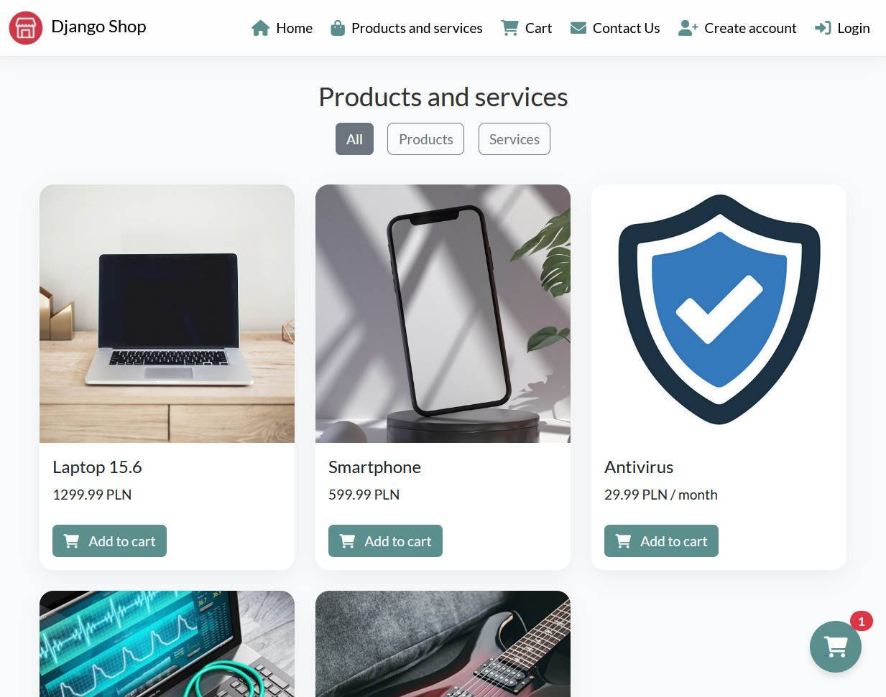

<p align="center">
  
</p>

<p align="center"><b>Pełnoprawna aplikacja webowa sklepu internetowego stworzona w Django</b></p>

---

## 🛠️ Technologie
| Warstwa | Technologie                             |
|----------|-----------------------------------------|
| **Backend** | Django, Python 3, SQLite (ORM)          |
| **Frontend** | HTML, CSS, JavaScript, Django Templates |

---

## 🚀 Funkcjonalności

### 🧩 Backend (Django)
- 🔐 **System logowania i rejestracji użytkowników**
- 🛒 **Koszyk** oparty na sesji z możliwością składania zamówień na wiele produktów
- 📦 **Śledzenie stanów magazynowych**
- 📬 **Wysyłanie podsumowania zamówienia e-mailem**  
  (domyślnie tryb testowy – podgląd wiadomości w przeglądarce)
- ✉️ **Formularz kontaktowy** z wiadomością wysyłaną do sklepu
- ➕ **Panel administratora (Django Admin)**  
  - dodawanie produktów i wielu zdjęć do jednego produktu  
  - podgląd zamówień i użytkowników  
- 🔢 **Captcha matematyczna** przy rejestracji, składaniu zamówienia i formularzu kontaktowym
- 🧠 **ORM Django + baza SQLite** (kilka produktów testowych jest już wgranych)
- 🚚 **Automatyczne uzupełnianie danych wysyłki**, gdy użytkownik jest zalogowany

### 🎨 Frontend
- 🧠 Wygenerowany przez **AI**, dopasowany i dostosowany przeze mnie
- ⚙️ Renderowanie widoków w Django z dynamicznym wstawianiem danych do szablonów
- 📱 **Responsywny design** – działa poprawnie na desktopie i urządzeniach mobilnych
- 💅 Czysty kod HTML, CSS, JS – bez frameworków frontendowych

---

## 🖼️ Screenshot

<p align="center">
  
</p>


---

## ⚙️ Instrukcja uruchomienia

**1️⃣ Sklonuj repozytorium:**
```
git clone https://github.com/jakubwprojects/JW_DJANGO_SHOP.git
cd JW_DJANGO_SHOP
```

**2️⃣ Utwórz i aktywuj środowisko wirtualne (opcjonalnie):**
```
python -m venv .venv
```
Windows:
```
.venv\Scripts\activate
```
Linux / Mac:
```
source .venv/bin/activate
```

**3️⃣ Zainstaluj wymagane pakiety:**
```
pip install -r requirements.txt
```

**4️⃣ Uruchom serwer lokalnie:**
```
python manage.py runserver
```

**5️⃣ Wejdź w przeglądarce pod adres: 👉 http://127.0.0.1:8000/**

**6️⃣ Testowe konto administratora:**

- Login: `admin`
- Hasło: `1234`

> Konto dostępne w panelu logowania. 
---

## ✍️ Autor

**Jakub W**  

✉️ **[jakubw.devmail@gmail.com](mailto:jakubw.devmail@gmail.com)**  

---